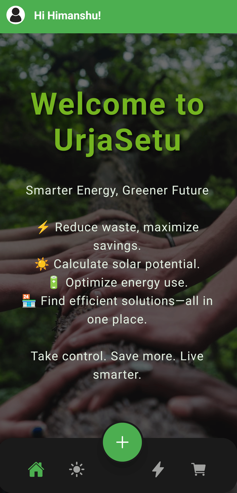
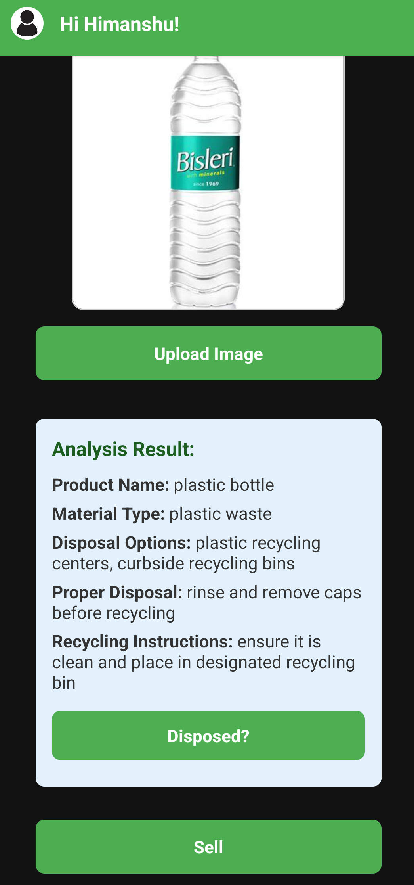
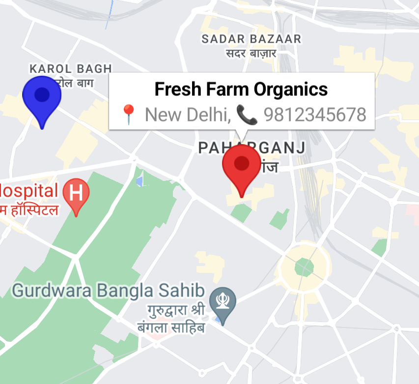
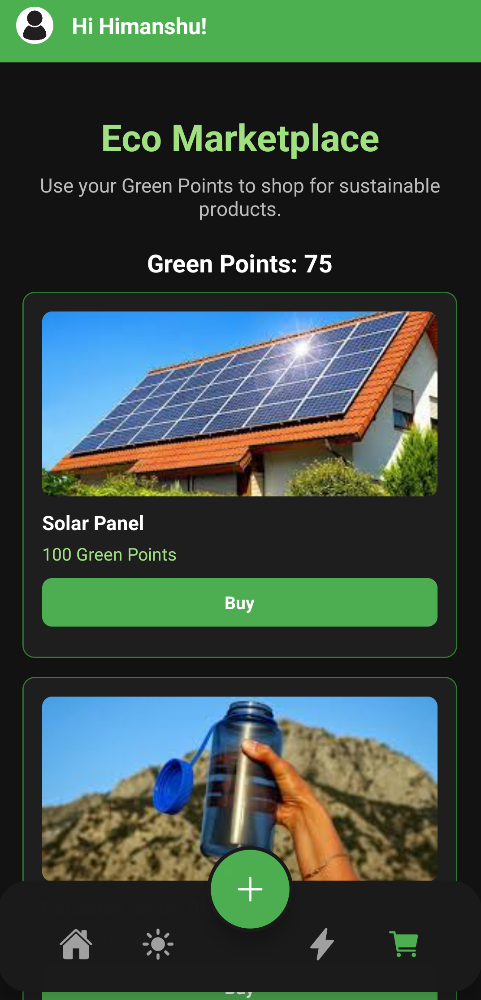
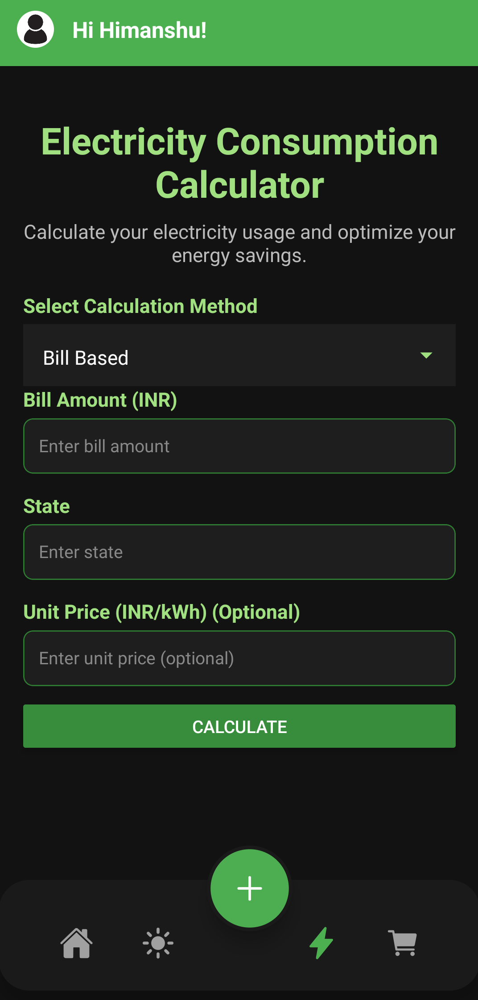

# UrjaSetu

A sustainability mobile app for image-based waste guidance, nearby collection vendors, Green Points, and solar and electricity calculators.

---

## Architecture

```text
┌─────────────────────────────────────────────────────────────┐
│                        Mobile app                           │
│  Expo • React Native • Expo Router                          │
└─────────────────────────────────────────────────────────────┘
                              ↓
┌────────────────────────────────────────────────────────────────────┐
│                     REST API (Express, Kafka)                      │
│  Users • Vendors • Waste image • Solar • Electricity               │
└────────────────────────────────────────────────────────────────────┘
                              ↓
┌─────────────────────────────────────────────────────────────┐
│                     Data and helpers                        │
│  MongoDB • Imagga image tags • geocoding                    │
└─────────────────────────────────────────────────────────────┘
```

## Features

### Home



### Waste photo upload



### Nearest vendor



### Green Points marketplace



### Electricity calculator

